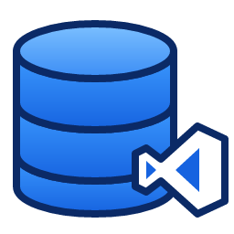

# DB Client

[English](README.md)

## Instalación

Descarga `dbclient-<versión>.vsix` (o genéralo con `npm install && npm run package`); luego, en VS Code o Cursor, abre la paleta de comandos (`Ctrl/Cmd+Shift+P`), ejecuta **Extensions: Install from VSIX…** y elige el archivo. Requiere VS Code 1.90 o superior; las conexiones SQLite requieren un editor con Node 22.13 o superior (Cursor, VS Code 1.101+). No necesita módulos nativos ni clientes de bases de datos.

## Qué es

Un cliente de bases de datos dentro del editor. Las conexiones a PostgreSQL, MySQL, SQL Server, Oracle, SQLite, Redis y NATS están en un solo árbol, y cada tipo abre su propio editor: un editor SQL inspirado en el de NetBeans, un editor de comandos Redis con visor de valores y una consola NATS.

Las conexiones se guardan una sola vez por usuario y se comparten entre todas las ventanas y espacios de trabajo. Las contraseñas y los tokens van al almacenamiento seguro del editor, nunca al archivo de configuración.

## Funcionalidades

| Área | Qué ofrece |
|---|---|
| Conexiones | Un solo árbol para todos los motores; crear, editar, duplicar, eliminar, probar, conectar y desconectar desde un formulario. |
| Carpetas | Agrupar conexiones en carpetas anidadas; crear, renombrar, eliminar (el contenido sube un nivel), mover con **Move to Folder…** o arrastrando y soltando. |
| Almacenamiento | `connections.json` a nivel de usuario; secretos en el almacenamiento seguro del editor. |
| Explorador (SQL) | Bases/esquemas → tablas, vistas, funciones, procedimientos, triggers, índices (Oracle: paquetes, secuencias) → columnas con tipo, PK y NOT NULL. |
| Editor SQL | Selector de conexión en la barra de estado y en la barra del editor; ejecutar la sentencia bajo el cursor, la selección o el archivo completo; ▶ Run sobre cada sentencia; cancelar. |
| División de sentencias | `;` en todos los motores, más `GO` (SQL Server), `DELIMITER` (MySQL), `/` y bloques PL/SQL (Oracle), cuerpos `$$` (PostgreSQL) y triggers (SQLite). |
| Resultados | Panel inferior con una pestaña por conjunto de resultados, opción de conservar pestañas, paginación, orden, selección de filas, copiar como TSV y exportar a CSV/JSON. |
| Salida SQL | Cada sentencia queda registrada con su tiempo, filas traídas/afectadas y errores; los errores llevan a la línea y columna del editor y quedan subrayados. |
| Autocompletado SQL | Palabras clave, tipos y funciones del dialecto de la conexión. |
| Explorador Redis | Bases con su número de llaves → llaves agrupadas por separador (`:`) con su tipo, usando `SCAN`. |
| Editor Redis | Archivos `.redis`, un comando por línea; autocompletado de comandos, opciones y llaves existentes; pide confirmación antes de `FLUSHDB`/`FLUSHALL`. |
| Valores Redis | Visor/editor de string, hash, list, set, sorted set y stream; TTL, renombrar y eliminar. |
| NATS | Publicar con headers, request/reply, suscribirse con comodines `*`/`>` y grupos de cola, lista de mensajes en vivo; streams y consumers de JetStream en el árbol. |

## Uso

**Agregar una conexión.** Abre la vista **DB Client** en la barra de actividad, pulsa **+**, elige el tipo, completa el formulario, pulsa **Test** y luego **Save**. Expande la conexión para explorarla.

**Organizar con carpetas.** Pulsa el botón **New Folder** en el título de la vista (o **New Folder** sobre una carpeta para crear una subcarpeta). Arrastra conexiones o carpetas sobre una carpeta, o usa **Move to Folder…**; suéltalas en un espacio vacío para devolverlas al nivel superior. **Add Connection** sobre una carpeta crea la conexión dentro de ella, y el campo **Folder** del formulario permite cambiarla después.

**Consultar una base SQL.** Pulsa **New Query** sobre una conexión o una base. Escribe SQL y pulsa `Ctrl/Cmd+Enter` para ejecutar la sentencia bajo el cursor (o la selección), o `Ctrl/Cmd+Shift+Enter` para ejecutar el archivo completo:

```sql
select id, name from customers where created_at > now() - interval '7 days';
update customers set active = false where id = 42;
```

Cada consulta abre una pestaña en **DB Client → Results**; la pestaña **Output** lista cada sentencia con su tiempo y número de filas.

**Ejecutar un lote de SQL Server o un bloque de Oracle.** Separa los lotes con `GO` y los bloques PL/SQL con `/`:

```sql
create or alter procedure dbo.touch as
begin
  update dbo.items set updated_at = sysdatetime();
end
GO
exec dbo.touch;
```

**Trabajar con Redis.** Pulsa **New Query** sobre una conexión Redis o sobre una de sus bases (`db0`, `db1`…) y escribe un comando por línea; `Ctrl/Cmd+Enter` ejecuta la línea actual o las líneas seleccionadas:

```redis
HSET user:1 name "Ana Maria" age 30
HGETALL user:1
EXPIRE user:1 3600
```

Haz clic en una llave del árbol para abrir su visor de valores y editarla.

**Publicar y suscribirse con NATS.** Pulsa **Open NATS Console** sobre una conexión NATS. Suscríbete a `orders.>` y publica en `orders.created` con un payload JSON y headers como `X-Trace: abc`; los mensajes recibidos aparecen en la lista y, al seleccionar uno, se ven su payload y sus headers.

## Configuración

| Opción | Valor por defecto | Descripción |
|---|---|---|
| `dbclient.maxRows` | 5000 | Filas traídas por sentencia; los resultados más grandes se truncan. |
| `dbclient.pageSize` | 100 | Filas por página en la grilla de resultados. |
| `dbclient.codeLens` | true | Mostrar ▶ Run sobre cada sentencia SQL. |

## Desarrollo

```bash
npm install
npm run build        # empaqueta en dist/
npm test             # pruebas unitarias; las de integración corren si hay variables DBCLIENT_*
npm run test:smoke   # ejecuta la extensión dentro de un VS Code descargado
npm run package      # genera el .vsix
```

Pulsa **F5** en esta carpeta para abrir un Extension Development Host. Los requisitos y el avance están en [spec.md](spec.md).
